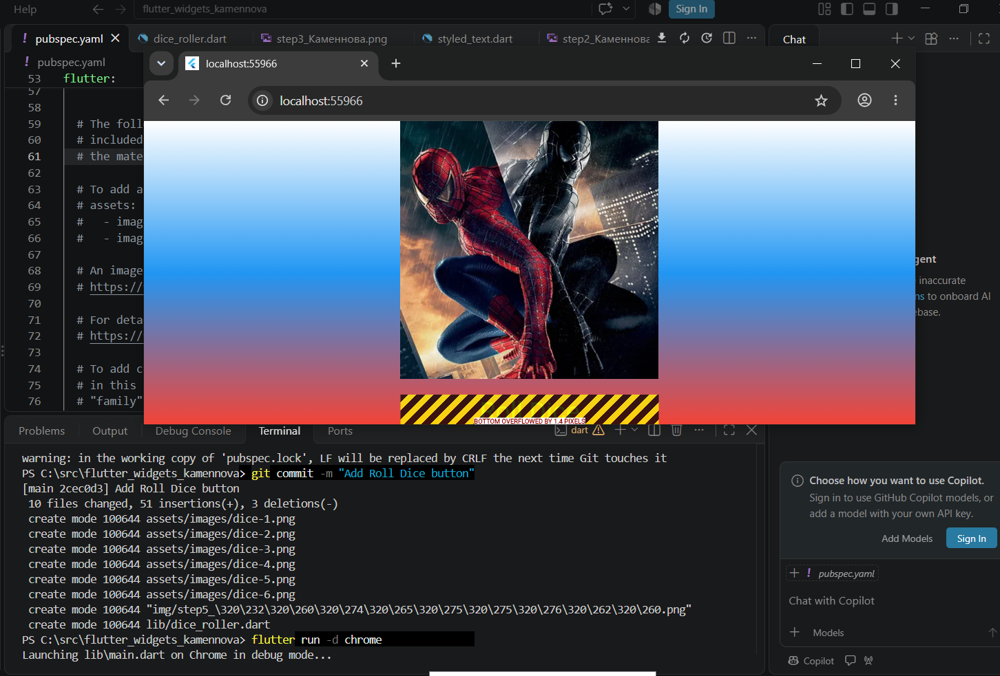

# Roll Dice App (Лабораторная работа №4–5)

Интерактивное Flutter-приложение «Roll Dice App» (бросок игрального кубика), построенное с использованием компонентного подхода, пользовательских виджетов и управления состоянием через `StatefulWidget`.

## Автор
Каменнова Соamя, ИСП-242
Дата сдачи: 23.11.2026

## Репозиторий
https://github.com/sonyakamennova/Flutter_Widgets4-5---

## Скриншот приложения

## Инструкция по запуску
1. Клонировать репозиторий: `git clone <URL_вашего_репозитория>`
2. Перейти в папку проекта: `cd flutter_widgets_kamennova`
3. Установить зависимости и ресурсы: `flutter pub get`
4. Запустить в браузере: `flutter run -d chrome`

## Что изучили
* Построение интерфейса во Flutter через дерево виджетов и декомпозицию UI на отдельные классы и файлы (`snake_case`).
* Создание собственных виджетов без состояния (`StatelessWidget`) и передачу данных в них через параметры конструктора.
* Подключение локальных изображений (`assets`) через настройку файла `pubspec.yaml` и отображение через `Image.asset`.
* Управление динамическим состоянием интерфейса с помощью `StatefulWidget`, объекта `State` и метода `setState()`.
* Генерацию случайных чисел в Dart с использованием библиотеки `dart:math` и класса `Random`.

## Ответы на контрольные вопросы

**1. Зачем выносить виджеты в отдельные файлы? Что изменится если держать всё в `main.dart`?**
Разделение виджетов по отдельным файлам делает проект читаемым, упрощает навигацию, командную работу и позволяет легко переиспользовать компоненты в разных частях приложения. Если держать весь код в `main.dart`, файл быстро разрастётся до тысяч строк, в нём станет сложно искать ошибки, увеличится время рефакторинга и возрастут конфликты при совместной работе в Git.

**2. Что такое `BuildContext`? Почему метод `build()` принимает его как параметр?**
`BuildContext` — это объект-ссылка на конкретное место виджета в общем дереве виджетов приложения. Метод `build()` принимает его для того, чтобы виджет мог понимать своё окружение в иерархии UI и при необходимости получать доступ к данным родительских виджетов (например, к теме оформления `Theme.of(context)` или размерам экрана `MediaQuery.of(context)`).

**3. Чем `StatelessWidget` отличается от `StatefulWidget`? Приведите пример когда нужен каждый из них.**
`StatelessWidget` является неизменяемым (статичным): он отрисовывается один раз на основе переданных параметров и не хранит внутреннее состояние (пример — фоновый контейнер с градиентом `GradientContainer` или заголовок). `StatefulWidget` имеет связанный объект `State`, умеет хранить изменяемые данные и перерисовывать интерфейс при вызове `setState()` (пример — виджет броска кубика `DiceRoller`, счётчик кликов или форма ввода).

**4. Почему `Random()` создаётся на уровне файла, а не внутри `rollDice()`?**
Если создавать `Random()` внутри `rollDice()`, то при каждом нажатии кнопки в памяти будет выделяться и инициализироваться новый объект генератора случайных чисел. Создание одного объекта `final randomizer = Random();` на уровне файла позволяет переиспользовать один и тот же экземпляр генератора при каждом броске, экономя память и ресурсы процессора.
